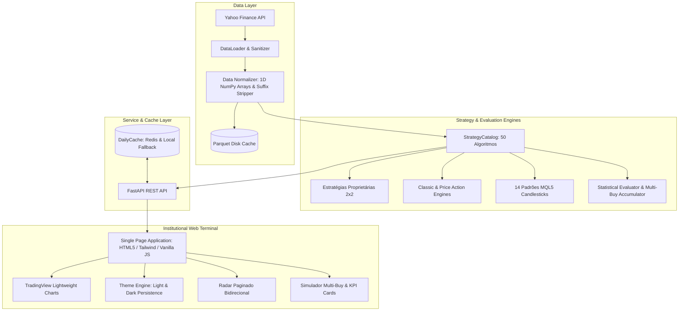

<div align="center">

# 📊 Market Opportunity & Statistical Engine
### *Institutional-Grade Quantitative Trading Terminal & Systematic Alpha Engine*

[](https://www.python.org/)
[](https://fastapi.tiangolo.com/)
[](https://tradingview.github.io/lightweight-charts/)
[](https://redis.io/)
[](https://pytest.org/)
[](https://github.com/)
[](https://github.com/)
[](https://opensource.org/licenses/MIT)

<p align="center">
  <b>Um motor analítico quantitativo bidirecional (Compra & Venda) para varredura multiativos em tempo real, backtesting com viés de antecipação estritamente zero (Zero Look-Ahead Bias), suporte a múltiplos tempos gráficos (inclusive 5m intradiário) e interface gráfica de alta performance com temas Claro / Escuro inspirada em terminais institucionais (Bloomberg / TradingView).</b>
</p>

[Visão Geral](#-visão-geral) •
[Novas Funcionalidades](#-novas-funcionalidades-v21) •
[Destaques de Engenharia](#-destaques-de-engenharia) •
[Arquitetura](#-arquitetura-do-sistema) •
[Catálogo de Estratégias](#-catálogo-de-estratégias-50-modelos) •
[Como Executar](#-como-executar) •
[API & Contratos](#-api--contratos-rest) •
[Testes](#-testes--qualidade)

---

</div>

## 🌟 Visão Geral

O **Market Opportunity & Statistical Engine** foi desenhado para resolver o principal desafio de sistemas de trading sistemático e alocação de capital: **a identificação confiável e estatisticamente comprovada de pontos de reversão (fundos e topos de mercado)**, sem vazamento temporal de dados (*look-ahead bias*) e com processamento de sub-segundo em universos de centenas de ativos.

O sistema integra:
1. **Radar de Mercado Paginado**: Varredura instantânea de mais de 150 ativos (B3, NYSE, Nasdaq, FIIs, Cripto, Futuros e Commodities) com semáforo de *Timing* (Ideal, Estendido ou Atrasado) e filtros multi-select de estratégia.
2. **Terminal Gráfico Interativo**: Candlesticks em Canvas TradingView de alta taxa de quadros, marcadores causais de compra/venda, linhas de estrutura dinâmicas e controles de zoom in/out/reset.
3. **Simulador Multi-Buy de Ciclos de Trade & Acumulação**: Compra em absolutamente **todos os sinais de compra confirmados** antes de um sinal de venda, acumulando cotas e recalculando o preço médio ponderado, com liquidação unificada de 100% da posição no topo.
4. **Tema Claro & Escuro (Light & Dark Mode)**: Alternância instantânea com paleta executiva fintech moderna (`#F8FAFC`), contraste balanceado e adaptação dinâmica dos gráficos TradingView e Plotly.
5. **Otimizador de Pares de Estratégia**: Algoritmo de busca combinatorial que identifica o melhor par de entrada e saída para maximizar retorno, Fator de Lucro e Win Rate.

---

## 🚀 Novas Funcionalidades (v2.1)

### 1. Seletor de Modelo de Ciclo (Compra Única 1x vs Acumulação Multi-Buy Nx) & Otimizador Alinhado
- **Duas Abordagens Operacionais Selecionáveis**:
  - **Compra Única (1x por Ciclo)**: executa apenas a 1ª compra confirmada após a liquidação do ciclo anterior e ignora compras adicionais até a venda, mantendo o capital investido fixo e operando com posição contida.
  - **Acumulação Multi-Buy (Nx por Ciclo)**: executa compras em todos os sinais de compra confirmados no ciclo, acumulando cotas e recalculando o **Preço Médio Ponderado**:
    $$\text{Preço Médio} = \frac{\sum (Q_i \times P_i)}{\sum Q_i}$$
- **Otimizador ("Mais Lucrativa") Sincronizado**:
  - O motor do otimizador de estratégias varre pares respeitando o tempo gráfico selecionado no simulador (inclusive intradiário 5m/15m/60m) e o modelo de ciclo ativo (1x ou Multi-Buy).
  - A ação **"Aplicar e Simular"** produz convergência matemática de **100% de exatidão** entre as métricas exibidas no card da combinação campeã e os cards de KPI do simulador.
- **Radar Reativo Bidirecional (Compra, Venda e Ambos)**:
  - Navegação reativa instantânea entre sinais de fundo (`Compra`), topo (`Venda`) e visão consolidada (`Ambos`), com paginação integrada ao servidor e atualização dinâmica de estratégias.
- **Contabilidade Realista de Fluxo de Caixa e Reinvestimento**:
  - Quando um sinal de venda (`SELL`) liquida a posição, 100% do montante apurado (capital inicial + lucros/prejuízos) retorna integralmente para a carteira líquida (`cash`).
  - As compras de ciclos subsequentes utilizam prioritariamente o saldo em caixa disponível antes de computar novo aporte de capital externo do bolso do investidor.
  - O **Capital Investido** e o **Retorno Global (%)** expressam com exatidão matemática o capital real desembolsado e a rentabilidade acumulada, eliminando distorções de alavancagem artificial.
- A tabela de histórico detalha cada ciclo com status semântico (`LUCRO`, `PREJUÍZO`, `EM ABERTO`) e exibe todas as sub-entradas com data, preço individual e quantidade de cotas.

### 2. Modo Visual Claro / Escuro (Theme Toggle)
- Botão seletor no cabeçalho institucional (ícone 🌙/☀️) com persistência automática no `localStorage`.
- Paleta clara fintech de alto contraste, sem ofuscamento, ideal para apresentações e relatórios executivos.
- Sincronização em tempo real das cores de fundo, grades, eixos e tipografia do **TradingView Lightweight Charts** e **Plotly.js**.

### 3. Cards de KPIs Institucionais no Simulador
- **Retorno Estratégia vs. Buy & Hold**: Comparativo direto do alfa gerado contra a valorização simples do ativo no mesmo intervalo temporal.
- **Fator de Lucro (Profit Factor)**: Razão entre o somatório de lucros brutos e perdas brutas.
- **Taxa de Acerto (Win Rate %)**: Percentual de ciclos fechados no lucro com detalhamento do total de vitórias e derrotas.
- **Max Drawdown % & Média de Compras por Ciclo**: Avaliação profunda da resiliência patrimonial e do perfil de acumulação tática da estratégia.

### 4. Suporte Robusto a Timeframe 1h / 60m & Ergonomia Contextual
- **Execução sem Erro 400 no Timeframe de 1h (`60m` / `1h`)**:
  - Teto de histórico configurado para 730 dias (2 anos) no `DataLoader` e normalizado nos endpoints `/api/simulate` e `/api/simulate/optimize`, eliminando recusas da API e requisições inválidas de 5 anos para velas horárias.
- **Ocultação Contextual do Seletor de Direção**:
  - O seletor global "Compra", "Venda" e "Ambos" permanece ativo onde define a visão dos ativos (**Radar** e **Gráfico**) e é automaticamente ocultado nas abas **Simulador** e **Playbook**, reduzindo ruído visual e alinhando a interface aos fluxos de backtest e documentação.

---

## ⚡ Destaques de Engenharia

- 🛡️ **Zero Look-Ahead Bias Garantido**: Nenhuma decisão na barra $t$ consome dados de $t+1$. Sinais são confirmados no fechamento e executados estritamente na abertura subsequente (`Open[t+1]`).
- ⚡ **Vetorização Numérica de Alta Performance**: Cálculos estruturados em arrays contíguos NumPy 1D e janelas móveis em Pandas, eliminando iterações lentas com `DataFrame.iterrows()`.
- 🚀 **Arquitetura de Cache Diário Multi-Camada (Redis + Disco + Memória)**:
  - Cache de primeiro nível com `redis-py` via `REDIS_URL`.
  - Mecanismo transparente de fallback para disco (`.cache/radar_daily`) e memória de processo em caso de indisponibilidade do Redis.
  - Invalidação determinística baseada na data do último pregão.
- 📄 **Paginação Sob Demanda do Radar**: Escaneamento inteligente fatiado por página (`page_size=20`), garantindo tempos de resposta consistentemente **$<200\text{ms}$**.
- 🎯 **Filtros Institucionais Anti-Exaustão**:
  - Eliminação de falsos fundos duplos em topos de mercado através de filtros de tendência (SMA50 / queda prévia $\ge 6\%$), posição relativa (rejeição em máximas de 60 barras) e IFR/RSI.

---

## 🏗️ Arquitetura do Sistema

O projeto adota uma arquitetura limpa e modular desacoplada em domínios de negócio claros:



---

## 🔬 Catálogo de Estratégias (50 Modelos)

O motor operacional possui suporte nativo a **50 variações quantitativas** distribuídas entre operações de Compra (Fundos) e Venda (Topos):

| Grupo | Direção | Estratégias Principais |
|---|:---:|---|
| **Proprietárias (2x2)** | `BUY` / `SELL` | Negação de Rompimento Causal da Barra Anterior (`t1_open`, `t1_retest`) e de Fundo/Topo em $N$ Barras (`t2_open`, `t2_retest`). |
| **Price Action Institucional** | `BUY` | **Fundo Duplo + BOS (Refinado)**: com filtros de SMA50, máxima de 60 barras, RSI e queda prévia.<br>**Topo Duplo Invertido**: captura de exaustão em pullback comprador.<br>**Wyckoff Spring**: varredura de liquidez com rejeição e volume acima da média. |
| **Price Action Institucional** | `SELL` | **Topo Duplo + BOS (Refinado)**: com filtros simétricos de contexto de alta.<br>**Fundo Duplo Invertido**: captura de distribuição em rali.<br>**Wyckoff Upthrust (UTAD)**: falso rompimento de resistência com volume. |
| **Alocação Quantitativa** | `BUY` / `SELL` | **DCA Dinâmico**: compras por desvio estatístico ($Z \le -2.0$) e RSI < 30.<br>**Value Proxy**: Mayer Multiple e Dividend Yield Rolling 12m.<br>**Rebalanceamento de Carteira**: gatilhos causais de desvio de banda (+/- 5%). |
| **Candlesticks MQL5 (14+14)** | `BUY` / `SELL` | Martelo, Engolfo, Linha Perfurante, Estrela da Manhã, Harami, Soldados/Corvos Brancos, Doji Libélula/Lápide, etc. (Artigo 101 MQL5). |

---

## 🚀 Como Executar

### Pré-requisitos
- Python 3.10 ou superior.
- (Opcional) Instância do Redis rodando localmente ou em nuvem.

### 1. Clonar e Instalar Dependências
```bash
git clone https://github.com/SEU-USUARIO/market-opportunity-engine.git
cd market-opportunity-engine
python -m venv venv
source venv/bin/activate  # No Windows: venv\Scripts\activate
pip install -r requirements.txt
```

### 2. Configurar Variáveis de Ambiente (Opcional)
```bash
# Para utilizar Redis (opcional - fallback automático em disco/memória ativo)
export REDIS_URL="redis://localhost:6379/0"  # No Windows PowerShell: $env:REDIS_URL="redis://localhost:6379/0"
```

### 3. Iniciar o Servidor
```bash
python run_server.py
```
Acesse no navegador: **`http://localhost:8000`**

---

## 📡 API & Contratos REST

A API foi projetada para alto rendimento e documentação viva OpenAPI / Swagger:

- **`GET /api/health`**: Verificação de integridade e status do backend de cache ativo (`redis` ou `disk`).
- **`GET /api/strategies`**: Catálogo completo das 50 estratégias agrupadas por família e direção.
- **`GET /api/radar`**: Varredura paginada de oportunidades com semáforo de *Timing*.
- **`GET /api/analyze`**: Retorna série OHLCV, sinais históricos causalmente validados, linhas de referência e rankings estatísticos.
- **`POST /api/simulate`**: Execução de backtests com suporte a múltiplos aportes por ciclo, cálculo de preço médio e KPIs institucionais:
  ```json
  {
    "ticker": "PETR4.SA",
    "interval": "1d",
    "period": "2y",
    "simulation_mode": "cycle_trade",
    "initial_capital": 1000.0,
    "contribution_amount": 500.0
  }
  ```

Documentação interativa Swagger disponível em: **`http://localhost:8000/docs`**

---

## 🧪 Testes & Qualidade

O projeto conta com rigorosa cobertura de testes unitários e de integração, incluindo validações formais contra viés de antecipação temporal (*anti-look-ahead*):

```bash
# Executar suíte completa de testes
pytest -v
```

```text
======================= 51 passed in 4.79s =======================
```

---

## 💼 Perfil Profissional & Competências Demonstradas

Este projeto foi construído para demonstrar proficiência prática em:
- **Engenharia de Software Quantitativo**: Arquitetura de microsserviços rápidos em Python/FastAPI, com baixo consumo de memória e latência previsível.
- **Finanças Quantitativas**: Rigor metodológico causal, métricas de risco/retorno (Sharpe, Max Drawdown, Profit Factor, Win Rate), timing de ordens e simulação de custos operacionais.
- **Algoritmos & Estruturas de Dados**: Máquinas de estado finitas $O(N)$, indexação vetorial e pipelines de dados resilientes.
- **Desenvolvimento Web & UX Financeiro**: Criação de interfaces responsivas de padrão institucional, com temas Claro e Escuro, Canvas HTML5 de 60fps e controles ergonômicos para traders e analistas.

---

<div align="center">
  <sub>Desenvolvido com foco em excelência técnica, rigor quantitativo e alta performance.</sub>
</div>
