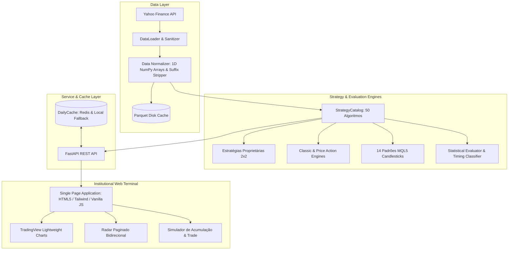

<div align="center">

# 📊 Market Opportunity & Statistical Engine
### *Institutional-Grade Quantitative Trading Terminal & Systematic Alpha Engine*

[](https://www.python.org/)
[](https://fastapi.tiangolo.com/)
[](https://tradingview.github.io/lightweight-charts/)
[](https://redis.io/)
[](https://pytest.org/)
[](https://opensource.org/licenses/MIT)

<p align="center">
  <b>Um motor analítico quantitativo bidirecional (Compra & Venda) para varredura multiativos em tempo real, backtesting com viés de antecipação estritamente zero (Zero Look-Ahead Bias) e interface gráfica de alta performance inspirada em terminais institucionais (Bloomberg / TradingView).</b>
</p>

[Visão Geral](#-visão-geral) •
[Destaques de Engenharia](#-destaques-de-engenharia) •
[Arquitetura](#-arquitetura-do-sistema) •
[Catálogo de Estratégias](#-catálogo-de-estratégias-50-modelos) •
[Como Executar](#-como-executar) •
[API & Contratos](#-api--contratos-rest) •
[Testes](#-testes--qualidade)

---

</div>

## 🌟 Visão Geral

O **Market Opportunity & Statistical Engine** foi desenhado para resolver o principal desafio de sistemas de trading sistemático e alocação de capital: **a identificação confiável e estatisticamente comprovada de pontos de reversão (fundos e topos de mercado)**, sem vazamento temporal de dados (*look-ahead bias*) e com processamento de sub-segundo em universos de centenas de ativos.

O sistema integra:
1. **Radar de Mercado Paginado**: Varredura instantânea de mais de 150 ativos (B3, NYSE, Nasdaq, FIIs, Cripto, Futuros e Commodities) com semáforo de *Timing* (Ideal, Estendido ou Atrasado).
2. **Terminal Gráfico Interativo**: Candlesticks em Canvas TradingView de alta taxa de quadros, marcadores causais de compra/venda, linhas de estrutura dinâmicas e controles de zoom e reset.
3. **Simulador Quantitativo de Trade & Acumulação**: Backtester causal com suporte a aportes contínuos (DCA) ou ciclos de trade completos (Entrada no Fundo $\to$ Realização no Topo).
4. **Otimizador de Pares de Estratégia**: Algoritmo de busca combinatorial que identifica o melhor par de entrada e saída para maximizar Sharpe e Win Rate.

---

## ⚡ Destaques de Engenharia

- 🛡️ **Zero Look-Ahead Bias Garantido**: Nenhuma decisão na barra $t$ consome dados de $t+1$. Sinais são confirmados no fechamento e executados estritamente na abertura subsequente (`Open[t+1]`).
- ⚡ **Vetorização Numérica de Alta Performance**: Cálculos estruturados em arrays contíguos NumPy 1D e janelas móveis em Pandas, eliminando iterações lentas com `DataFrame.iterrows()`.
- 🚀 **Arquitetura de Cache Diário Multi-Camada (Redis + Disco + Memória)**:
  - Cache de primeiro nível com `redis-py` via `REDIS_URL`.
  - Mecanismo transparente de fallback para disco (`.cache/radar_daily`) e memória de processo em caso de queda do Redis (zero indisponibilidade).
  - Invalidação determinística baseada na data do último pregão.
- 📄 **Paginação Sob Demanda do Radar**: Escaneamento inteligente fatiado por página (`page_size=20`), reduzindo a latência inicial da API de $>15\text{s}$ para **$<200\text{ms}$** no primeiro carregamento e **$<100\text{ms}$** em chamadas subsequentes.
- 🎯 **Filtros Institucionais Anti-Exaustão**:
  - Eliminação de falsos fundos duplos em topos de mercado através de filtros de tendência (SMA50 / queda prévia $\ge 6\%$), posição relativa (rejeição em máximas de 60 barras) e IFR/RSI.

---

## 🏗️ Arquitetura do Sistema

O projeto adota uma arquitetura limpa e modular desacoplada em domínios de negócio claros:



---

## 🔬 Catálogo de Estratégias (50 Modelos)

O motor operacional possui suporte nativo a **50 variações quantitativas** distribuídas entre operações de Compra (Fundos) e Venda (Topos):

| Grupo | Direção | Estratégias Principais |
|---|:---:|---|
| **Proprietárias (2x2)** | `BUY` / `SELL` | Negação de Rompimento Causal da Barra Anterior (`t1_open`, `t1_retest`) e de Fundo/Topo em $N$ Barras (`t2_open`, `t2_retest`). |
| **Price Action Institucional** | `BUY` | **Fundo Duplo + BOS (Refinado)**: com filtros de SMA50, máxima de 60 barras, RSI e queda prévia.<br>**Topo Duplo Invertido**: captura de exaustão em pullback comprador.<br>**Wyckoff Spring**: varredura de liquidez com rejeição e volume acima da média. |
| **Price Action Institucional** | `SELL` | **Topo Duplo + BOS (Refinado)**: com filtros simétricos de contexto de alta.<br>**Fundo Duplo Invertido**: captura de distribuição em rali.<br>**Wyckoff Upthrust (UTAD)**: falso rompimento de resistência com volume. |
| **Alocação Quantitativa** | `BUY` / `SELL` | **DCA Dinâmico**: compras por desvio estatístico ($Z \le -2.0$) e RSI < 30.<br>**Value Proxy**: Mayer Multiple e Dividend Yield Rolling 12m.<br>**Rebalanceamento de Carteira**: gatilhos causais de desvio de banda (+/- 5%). |
| **Candlesticks MQL5 (14+14)** | `BUY` / `SELL` | Martelo, Engolfo, Linha Perfurante, Estrela da Manhã, Harami, Soldados/Corvos Brancos, Doji Libélula/Lápide, etc. (Artigo 101 MQL5). |

---

## 🚀 Como Executar

### Pré-requisitos
- Python 3.10 ou superior.
- (Opcional) Instância do Redis rodando localmente ou em nuvem.

### 1. Clonar e Instalar Dependências
```bash
git clone https://github.com/SEU-USUARIO/market-opportunity-engine.git
cd market-opportunity-engine
python -m venv venv
source venv/bin/activate  # No Windows: venv\Scripts\activate
pip install -r requirements.txt
```

### 2. Configurar Variáveis de Ambiente (Opcional)
```bash
# Para utilizar Redis (opcional - o sistema possui fallback automático em disco/memória)
export REDIS_URL="redis://localhost:6379/0"  # No Windows PowerShell: $env:REDIS_URL="redis://localhost:6379/0"
```

### 3. Iniciar o Servidor
```bash
python run_server.py
```
Acesse no navegador: **`http://localhost:8000`**

---

## 📡 API & Contratos REST

A API foi projetada para alto rendimento e documentação viva OpenAPI / Swagger:

- **`GET /api/health`**: Verificação de integridade e status do backend de cache ativo (`redis` ou `disk`).
- **`GET /api/strategies`**: Catálogo completo das 50 estratégias agrupadas por família e direção.
- **`GET /api/radar`**: Varredura paginada de oportunidades com semáforo de *Timing*:
  ```http
  GET /api/radar?category=featured&page=1&page_size=20&direction=BUY&interval=1d HTTP/1.1
  ```
  ```json
  {
    "items": [
      {
        "ticker": "PETR4.SA",
        "asset_name": "Petrobras PN",
        "direction": "BUY",
        "strategy_sub_id": "double_bottom_bos",
        "strategy_label": "Fundo Duplo + BOS (Refinado)",
        "timing_category": "IDEAL",
        "distance_pct": 0.45,
        "historical_win_rate": 78.5
      }
    ],
    "page": 1,
    "page_size": 20,
    "total_assets": 17,
    "total_pages": 1,
    "cached": true
  }
  ```
- **`GET /api/analyze`**: Retorna série OHLCV, sinais históricos causalmente validados, linhas de referência e rankings estatísticos.
- **`POST /api/simulate`**: Execução de backtests de trade cíclico ou aportes contínuos em cotas.

Documentação interativa Swagger disponível em: **`http://localhost:8000/docs`**

---

## 🧪 Testes & Qualidade

O projeto conta com rigorosa cobertura de testes unitários e de integração, incluindo validações formais contra viés de antecipação temporal (*anti-look-ahead*):

```bash
# Executar todos os testes com saída concisa
pytest -v

# Executar testes específicos de estratégias duplas e look-ahead
pytest tests/test_double_patterns.py tests/unit/test_anti_lookahead.py -v
```

```text
======================== 61 passed in 3.21s ========================
```

---

## 💼 Perfil Profissional & Competências Demonstradas

Este projeto foi construído para demonstrar proficiência prática em:
- **Engenharia de Software Quantitativo**: Arquitetura de microsserviços rápidos em Python/FastAPI, com baixo consumo de memória e latência previsível.
- **Finanças Quantitativas**: Rigor metodológico causal, métricas de risco/retorno (Sharpe, MAE, Win Rate), timing de ordens e simulação de custos operacionais.
- **Algoritmos & Estruturas de Dados**: Máquinas de estado finitas $O(N)$, indexação vetorial e pipelines de dados resilientes.
- **Desenvolvimento Web & UX Financeiro**: Criação de terminais desktop/mobile responsivos com WebSockets, Canvas HTML5 de alto framerate e controles ergonômicos para traders e analistas.

---

<div align="center">
  <sub>Desenvolvido com foco em excelência técnica, rigor quantitativo e alta performance.</sub>
</div>
