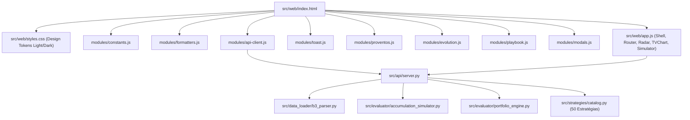

# Relatório de Arquitetura, Auditoria e Execução — Market Opportunity & Bottom Statistical Engine (`feat/023-penpot-full-ui`)

## 1. Resumo Executivo

Este documento consolida a transformação arquitetural, correção de integridade financeira, modularização incremental do frontend, implementação integral das **13 pranchas do Penpot** (`Market Opportunity — Complete System Redesign`) e validação automatizada (unitária, contratual e E2E Playwright) executada na branch `feat/023-penpot-full-ui`.

### Principais entregas concluídas:
1. **Integridade Financeira e Conciliação B3**:
   - Eliminação de caixa fictício inicial (`availableCash = 0.0` por padrão em vez de `R$ 10.000,00`).
   - Eliminação da rampa sintética de 12 meses (`0.65 + idx * 0.032`) na Visão Geral; exibição estrita de séries reais importadas ou ponto único real (`Posição Atual`).
   - Conciliação e deduplicação determinística de múltiplos extratos B3 (`.xlsx`, `.xls`, `.csv`, `.txt`) cobrindo Negociação e Movimentação (Dividendos, JCP e Rendimentos FII).
2. **Rigor Matemático no Backend e Simulador (`/api/simulate` & `/api/simulate/optimize`)**:
   - No modo Acumulação (`accumulation`), filtragem estrita de sinais `BUY` confirmados (sinais `SELL` jamais disparam compras em DCA).
   - Respeito estrito ao corte temporal `end_date` na avaliação de `current_price` / `last_close` (`close_sliced[-1]`), eliminando *look-ahead bias* fora da janela selecionada.
   - Cálculo real de `max_drawdown_pct` sobre a curva patrimonial no modo DCA (`_compute_max_drawdown_pct`).
   - Retorno honesto `None` para `dca_regular_final_value` e `alpha_vs_dca_pct` quando o benchmark DCA mensal fixo não é computado separadamente.
3. **Segurança e Ciclo de Vida da API FastAPI (`src/api/server.py`)**:
   - Migração do hook depreciado `@app.on_event("startup")` para `@asynccontextmanager async def _lifespan(app: FastAPI)`.
   - Configuração segura de `CORSMiddleware` via variável de ambiente `ALLOWED_ORIGINS` sem combinação insegura de `allow_origins=["*"]` com `allow_credentials=True`.
   - Limites de segurança no endpoint `POST /api/b3/parse`: máximo de 10 arquivos por requisição (`HTTP 400`), validação de extensões permitidas (`HTTP 415`), limite de tamanho por arquivo (`MAX_B3_UPLOAD_MB`, padrão 10MB, `HTTP 413`) e sanitização de mensagens de erro.
4. **Arquitetura Modular do Frontend (`src/web/modules/`)**:
   - `constants.js`: rotas canônicas, aliases de rotas, mapeamento de nomes institucionais e aliases de tickers.
   - `formatters.js`: formatação monetária BRL, percentuais, números tabulares, datas e sanitização de tickers.
   - `api-client.js`: cliente HTTP centralizado com tratamento padronizado de erros para todos os endpoints REST.
   - `toast.js`: sistema de notificações (`role="status" aria-live="polite"`) e overlay de processamento.
   - `proventos.js`: 4 KPIs de Proventos, gráfico empilhado Mensal/Anual, barras de `Composição da renda` e tabela `Últimos proventos`.
   - `evolution.js`: controle temporal `12 meses` / `Tudo`, gráfico `Patrimônio x aportes`, card `Resumo do período` e tabela `Histórico de aportes e eventos`.
   - `playbook.js`: busca em tempo real (`#playbook-search-input`), filtros por direção/risco (`Todas`, `Compra`, `Venda`, `Risco`) e grid de cards das estratégias (`#playbook-cards-grid`).
   - `modals.js`: widgets da Visão Geral (`#overview-highlights-tbody` e `#overview-donut-legend`), tela de Posições & Custódia (`#custody-kpis-grid`, filtros por classe, expandir/recolher e exportação CSV), Modal 09 (`#modal-b3-import`), Modal 10 (`#modal-new-trade`) e barra de navegação móvel (`#mobile-bottom-nav`).
5. **Correções de Bugs Visuais e de Runtime no Frontend**:
   - Correção do `ReferenceError: chartFontColor is not defined` em `renderPlotlyRanking()`, restaurando a renderização do gráfico horizontal `#plot-ranking` na tela de Gráfico Interativo.
   - Correção do card executivo `Maior Assimetria Hoje` no Radar (`updateRadarExecutiveDeck`), passando a ler `historical_win_rate ?? win_rate`.
   - Conectividade de todos os botões de ação anteriormente inertes (`Configurar %`, `12M`/`Tudo`, `+ Novo lançamento`, `Importar B3`, `Exportar CSV`).

---

## 2. Mapa de Dependências da Arquitetura Modular

---

## 3. Verificação e Evidências de Testes

- **Suíte Unitária, Financeira e de Contratos Estáticos**:
  - Comando: `./venv/bin/python -m pytest tests/unit tests/test_double_patterns.py tests/test_normalizer_suffix.py tests/test_radar_pagination.py -q`
  - Resultado: **150 passed, 0 failed, 0 skipped**.
- **Suíte End-to-End (Playwright Chromium)**:
  - Comando: `./venv/bin/python -m pytest tests/e2e -v`
  - Resultado: **34 passed, 0 failed, 0 skipped** (incluindo validação nos viewports `1600×1000`, `1024×768`, `390×844`, `375×900`, `768×900`, `1366×900` e `1920×900` nos temas Claro e Escuro).
