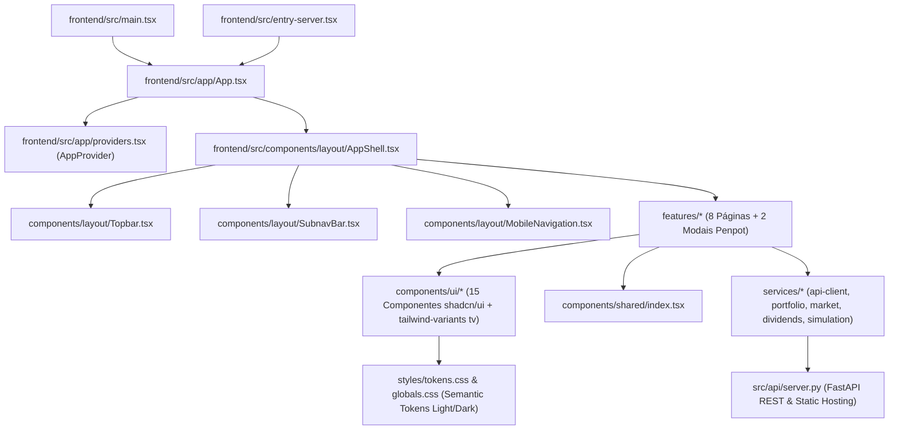

# Relatório de Arquitetura, Auditoria e Execução — Market Opportunity & Bottom Statistical Engine (`feat/react-shadcn-frontend`)

## 1. Resumo Executivo

Este documento consolida a migração completa e definitiva do frontend do **Market Opportunity & Bottom Statistical Engine** para **React 18 + TypeScript + Vite + Tailwind CSS + shadcn/ui + Tailwind Variants (`tv`)**, com fidelidade visual às **13 pranchas do Penpot** (`Market Opportunity — Complete System Redesign`), governança estrita de tokens CSS semânticos (zero códigos hexadecimais no código da aplicação) e eliminação do monolito legado `src/web/app.js` / `src/web/modules/`.

### Principais entregas concluídas:
1. **Migração Integral para React 18 + TypeScript + Vite (`frontend/`)**:
   - Criação da arquitetura modular em `frontend/src/` com separação limpa entre `app/`, `components/ui/`, `components/layout/`, `components/shared/`, `features/`, `services/`, `state/`, `styles/`, `types/` e `lib/`.
   - Pipeline de build + pré-renderização (`npm --prefix frontend run build`) que gera `src/web/index.html`, `src/web/styles.css` e `src/web/assets/react-app.js`, servidos diretamente pelo FastAPI (`src/api/server.py`) sem necessidade de servidor separado em produção.
   - Remoção definitiva do monolito legado `src/web/app.js` e dos scripts globais `src/web/modules/*.js`.
2. **Design System em `shadcn/ui` + Radix UI + `tailwind-variants` (`tv`)**:
   - Implementação padronizada de 15 componentes de base em `frontend/src/components/ui/` (`button.tsx`, `card.tsx`, `badge.tsx`, `input.tsx`, `label.tsx`, `select.tsx`, `tabs.tsx`, `dialog.tsx`, `table.tsx`, `checkbox.tsx`, `switch.tsx`, `skeleton.tsx`, `separator.tsx`, `scroll-area.tsx` e `financial-metric.tsx`) utilizando exclusivamente `import { tv, type VariantProps } from "tailwind-variants"`.
   - Zero uso de `class-variance-authority` (`cva`) ou códigos de cor hexadecimais (`#...`) nos arquivos `.ts`, `.tsx` e `.css`.
   - Centralização de todos os tokens visuais em `frontend/src/styles/tokens.css` usando notação funcional CSS (`rgb(...)` / `rgba(...)`) auditada para contraste WCAG AA (`>= 4.5:1`) nos temas Claro (`:root`) e Escuro (`[data-theme="dark"]`).
3. **Implementação das 13 Telas do Penpot em Módulos React de Funcionalidade**:
   - `OverviewPage.tsx` (Telas 01 e 11): 4 Hero KPIs, Evolução do Patrimônio, Alocação por Classe, Maiores Posições / Destaques, Composição por Ativo e Resumo Operacional B3.
   - `PortfolioPage.tsx` (Telas 02 e 12): 4 KPIs de Custódia, filtros por classe (`Todas`, `Ações`, `FIIs`, `ETFs`, `BDRs`, `Cripto`, `Renda Fixa`), busca por ticker, expandir/recolher grupos, exportação CSV e acordeões com tabelas roláveis por teclado.
   - `DividendsPage.tsx` (Tela 03): 4 KPIs de Proventos, gráfico empilhado Mensal/Anual por classe, barras de `Composição da renda` e tabela `Últimos proventos`.
   - `EvolutionPage.tsx` (Tela 04): seletor temporal `12 meses` / `Tudo`, gráfico de área dupla `Patrimônio x aportes`, card lateral `Resumo do período` e tabela `Histórico de aportes e eventos`.
   - `RadarPage.tsx` (Telas 05 e 13): 4 KPIs executivos, busca instantânea, pílulas de categoria, paginação sincronizada com `/api/radar` e tabela com semáforo de Timing e ação `Analisar`.
   - `ChartPage.tsx` (Tela 06): sidebar técnica com seletor de ativo, período, timeframe e 4 grupos de estratégias, canvas `TradingView Lightweight Charts` (`#tv-chart-container`), gráficos Plotly (`#plot-ranking` e `#plot-scatter`) e tabela de histórico de sinais.
   - `SimulatorPage.tsx` (Tela 07): formulário completo de backtest (`Ciclo de Trade` e `Acumulação DCA`), otimizador automático (`Mais Lucrativa` + `Aplicar e Simular`), 4 KPIs, curva patrimonial Plotly e tabela expansível de ciclos.
   - `PlaybookPage.tsx` (Tela 08): busca em tempo real, pílulas de direção/risco (`Todas`, `Compra`, `Venda`, `Risco`) e grid de cards das estratégias quantitativas.
   - `B3ImportDialog.tsx` (Tela 09) e `NewTransactionDialog.tsx` (Tela 10): modais acessíveis baseados em Radix Dialog / `shadcn/ui` para conciliação multi-arquivo B3 e lançamento manual com cálculo em tempo real.
   - `MobileNavigation.tsx` (Telas 11, 12 e 13): barra inferior responsiva (`#mobile-bottom-nav`) para viewports móveis (`390×844` e `375×900`).

---

## 2. Mapa de Dependências da Arquitetura Modular React + TypeScript

---

## 3. Verificação e Evidências de Testes

- **Typecheck TypeScript (`tsc --noEmit`)**:
  - Comando: `npm --prefix frontend run typecheck`
  - Resultado: **0 erros**.
- **Suíte Frontend React & Design System (Vitest + Testing Library)**:
  - Comando: `npm --prefix frontend run test`
  - Resultado: **9 passed (2 test files)** (`design-system.test.tsx` e `app-features.test.tsx`).
- **Suíte Completa Backend, Contratos Arquiteturais e E2E Playwright Chromium**:
  - Comando: `./venv/bin/python -m pytest tests -q`
  - Resultado: **185 passed, 0 failed, 0 skipped** (`151` testes unitários/contratos + `34` testes E2E Playwright nos viewports `1600×1000`, `1024×768`, `390×844`, `375×900`, `768×900`, `1366×900` e `1920×900` nos temas Claro e Escuro).
