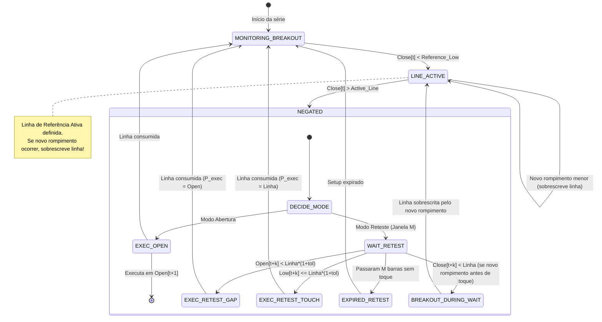

# Data Model: Market Opportunity & Bottom Statistical Engine

**Feature**: `001-market-opportunity-engine`
**Date**: 2026-10-19

## Core Data Structures & Contracts

### 1. `OHLCVSeries`
Representa a série temporal histórica higienizada do ativo financeiro.

```python
from dataclasses import dataclass
import pandas as pd
import numpy as np

@dataclass
class OHLCVSeries:
    ticker: str
    interval: str  # "1d" | "1wk"
    timestamps: np.ndarray  # int64 / datetime64[ns]
    open: np.ndarray        # float64
    high: np.ndarray        # float64
    low: np.ndarray         # float64
    close: np.ndarray       # float64
    volume: np.ndarray      # float64
    dividends: np.ndarray   # float64 (opcional/rolling)
    
    @property
    def length(self) -> int:
        return len(self.close)
```

### 2. `SignalRecord`
Contrato padronizado obrigatório gerado por qualquer motor de estratégia para representar uma execução de compra.

```python
from dataclasses import dataclass
from typing import Optional

@dataclass(frozen=True)
class SignalRecord:
    strategy_id: str             # ex: "prop_reversal", "mql5_hammer", "dca_dynamic"
    strategy_sub_id: str         # ex: "t1_open", "t1_retest", "t2_open", "t2_retest"
    signal_bar_index: int        # Barra onde a condição foi confirmada
    execution_bar_index: int     # Barra onde a compra foi preenchida (t_exec >= signal_bar_index)
    execution_price: float       # Preço real de compra (Open ou toque na linha/gap)
    reference_line_price: Optional[float] = None # Preço da linha de suporte/reteste (se houver)
    metadata: Optional[dict] = None # Dados auxiliares para auditoria/plot
```

### 3. `ReferenceLineSegment`
Segmento visual de uma Linha de Referência da Estratégia Proprietária para renderização gráfica e auditoria.

```python
@dataclass(frozen=True)
class ReferenceLineSegment:
    start_bar_index: int         # Barra de rompimento
    end_bar_index: int           # Barra de negação ou encerramento
    price_level: float           # Nível da mínima rompida
    status: str                  # "NEGATED_EXECUTED", "EXPIRED", "ACTIVE_PENDING"
    variation_id: str            # "Tipo 1 (t-1)" | "Tipo 2 (Fundo N)"
```

### 4. `StrategyStatsSummary`
Consolidação estatística calculada pelo `statistical_evaluator` para uma dada estratégia e horizonte $X$.

```python
@dataclass
class StrategyStatsSummary:
    strategy_id: str
    strategy_sub_id: str
    horizon_bars: int            # X (ex: 60)
    total_signals: int           # Total de sinais gerados
    executed_buys: int           # Total de compras preenchidas
    retest_fill_rate: float      # % de sinais de reteste preenchidos (1.0 se modo abertura)
    win_rate: float              # % onde Close[t_exec + X] > execution_price
    mean_forward_return: float   # Retorno médio percentual
    median_forward_return: float # Retorno mediano percentual
    mean_mae: float              # Excursão Máxima Adversa média (Drawdown médio pós-compra)
    max_mae: float               # Pior calor observado
    efficiency_score: float      # Score composto: (WinRate * MeanReturn) / (abs(MeanMAE) + 0.01)
```

## State Machine Model (Proprietary Reversal 2x2)


