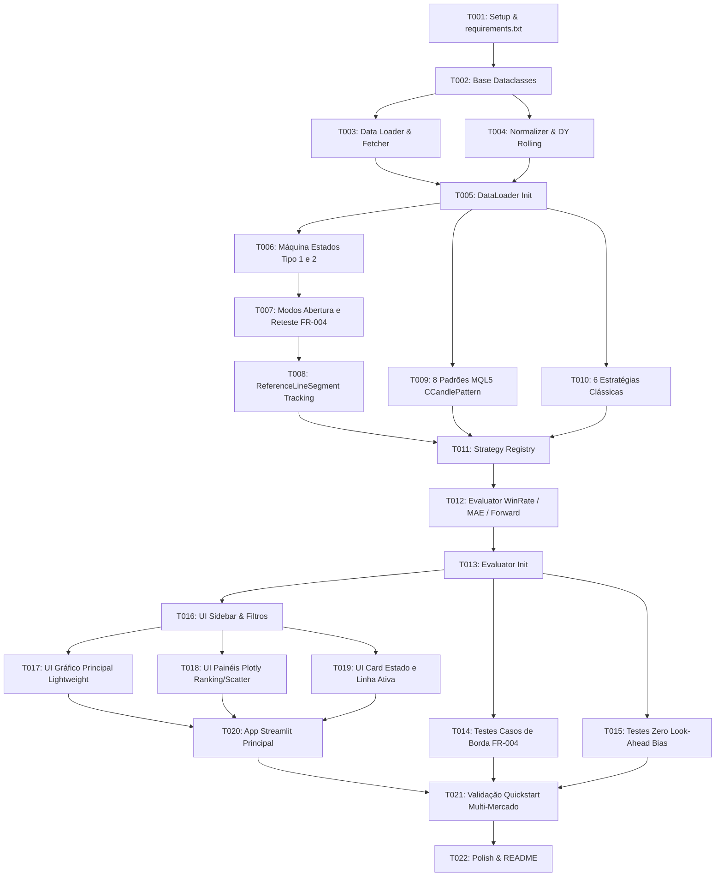

# Tasks: Market Opportunity & Bottom Statistical Engine

**Input**: Design documents from `/specs/001-market-opportunity-engine/`
**Prerequisites**: `plan.md`, `spec.md`, `research.md`, `data-model.md`, `contracts/interfaces.md`, `quickstart.md`
**Tests**: Testes unitários incluídos na Fase 6 para validação estrita da máquina de estados, regras de gap, reteste sequencial e garantia de zero look-ahead bias.
**Organization**: Tarefas agrupadas por blocos modulares e histórias de usuário, ordenadas por dependência estrita para execução eficiente sem perda de contexto.

## Format: `[ID] [P?] [Story] Description`
- **[P]**: Tarefas paralelizáveis (arquivos distintos e sem dependência mútua direta)
- **[Story]**: Mapeamento para história de usuário correspondente (`US1`, `US2`, `US3`, `US4`)
- Caminhos absolutos/relativos padronizados a partir da raiz do repositório

---

## Phase 1: Setup & Contratos Base (Infraestrutura Compartilhada)

**Goal**: Inicialização do repositório, dependências Python e estruturas de dados de domínio imutáveis.

- [X] T001 Criar arquivo de dependências `requirements.txt` contendo `streamlit`, `yfinance`, `pandas`, `numpy`, `plotly`, `streamlit-lightweight-charts`, `pyarrow`, `pytest` e criar a árvore de diretórios `src/` e `tests/`.
- [X] T002 [P] Implementar dataclasses fundamentais (`OHLCVSeries`, `SignalRecord`, `ReferenceLineSegment`, `StrategyStatsSummary`) em `src/strategies/base.py` conforme `data-model.md`.

---

## Phase 2: Data Loader & Cache Local (Foundational)

**Goal**: Ingestão robusta multi-mercado via `yfinance`, normalização de fuso-horário/OHLCV, cálculo de Dividend Yield Rolling 12m e persistência em cache local Parquet.

- [X] T003 Implementar `src/data_loader/fetcher.py` com `load_asset_data(ticker, interval, period, use_cache)` com suporte nativo a Ações EUA, Ações B3 (`.SA`), FIIs (`.SA`), Criptomoedas (`-USD`) e Commodities (`=F`), integrando cache persistente em `.cache/data/{ticker}_{interval}.parquet`.
- [X] T004 [P] Implementar `src/data_loader/normalizer.py` para limpeza de valores nulos, conversão para arrays NumPy 1D contíguos (`open`, `high`, `low`, `close`, `volume`) e cálculo de Dividend Yield Rolling 12m acumulado para ativos de renda variável/FIIs.
- [X] T005 Expor interface unificada no pacote `src/data_loader/__init__.py`.

---

## Phase 3: Motor Proprietário 2x2 - Negação de Rompimento (Priority: P1) [US1]

**Goal**: Implementação da Máquina de Estados $O(N)$ em NumPy puro rastreando as 4 combinações de rompimento e reteste, respeitando rigorosamente o FR-004 e gerando os segmentos visuais de linha de referência.

- [X] T006 [US1] Implementar em `src/strategies/proprietary_reversal.py` a Máquina de Estados $O(N)$ sobre arrays NumPy com as duas definições de Candle B: Tipo 1 (`Close[t] < Low[t-1]`) e Tipo 2 (`Close[t] < min(Low[t-N : t-1])`), suportando sobrescrita dinâmica da Linha de Referência Ativa em rompimentos sucessivos.
- [X] T007 [US1] Implementar em `src/strategies/proprietary_reversal.py` a lógica de execução dos dois modos:
  - Modo Abertura: execução em `t_exec = t + 1` com $P_{exec} = Open[t+1]$.
  - Modo Reteste sequencial em até $M$ barras:
    * Se `Open[t+k] < Linha * (1 + tol)` (Gap de Baixa): executa em `t_exec = t+k` com $P_{exec} = Open[t+k]$.
    * Se `Low[t+k] <= Linha * (1 + tol)`: executa em `t_exec = t+k` com $P_{exec} = Linha$ (mesmo que feche abaixo).
    * Ciclo único por janela $M$ (primeiro toque consome a linha e encerra o ciclo de compra).
- [X] T008 [US1] Rastrear e retornar lista de `ReferenceLineSegment` com início no rompimento e fim na negação/execução para renderização visual e monitor de estado.

---

## Phase 4: Motores MQL5 e Estratégias Clássicas (Priority: P1) [US1]

**Goal**: Implementação vetorizada dos 8 padrões clássicos de velas (Artigo 101 MQL5) e das 6 estratégias quantitativas adicionais, com execução rigorosa em `Open[t+1]`.

- [X] T009 [P] [US1] Implementar `src/strategies/mql5_candles.py` vetorizado conforme Artigo 101 do MQL5 (`CCandlePattern`), calculando `AvgBody = SMA(abs(Close - Open), 12)` e filtro de baixa `Close < SMA(20)` para: Martelo, Engolfo de Alta, Piercing Line, Estrela da Manhã, Harami de Alta, Três Por Dentro, Três Por Fora e Três Soldados Brancos, com execução padronizada em `Open[t_final + 1]`.
- [X] T010 [P] [US1] Implementar `src/strategies/classic_engines.py` com as estratégias vetorizadas:
  - DCA Dinâmico (`Close < SMA200 - k*StdDev` ou `RSI14 < 30`);
  - Rebalanceamento RF vs. RV (drawdown de banda de tolerância);
  - Força Relativa vs. Benchmark (Z-score 60 períodos $\le -2.0$);
  - Value Proxy com Fallback Quantitativo (DY Rolling $\ge 80\%$ + Desconto SMA200 ou Mayer Multiple $\le 15\%$);
  - Price Action Fundo Duplo com falha de continuação + BOS;
  - Wyckoff Spring (sweep de mínima com rejeição e volume acima da média de 20);
  - Todas com execução em `Open[t+1]`.
- [X] T011 [US1] Expor interface unificada e gerenciador de catálogo de estratégias em `src/strategies/__init__.py`.

---

## Phase 5: Avaliador Estatístico Anti-Viés (Priority: P1) [US1]

**Goal**: Módulo analítico isolado que avalia prospectivamente em $X$ barras o retorno, calor suportado (MAE), taxa de acerto de fundo e score de eficiência sem viés de antecipação.

- [X] T012 [US1] Implementar em `src/evaluator/statistical_engine.py` a função `evaluate_strategy_performance` calculando para horizonte $X$:
  - Total de Compras Executadas ($N$);
  - Taxa de Execução de Reteste (% de toques preenchidos);
  - Win Rate (% onde `Close[t_exec + X] > P_exec`);
  - Retorno Prospectivo Médio e Mediano (`(Close[t_exec + X] / P_exec) - 1.0`);
  - Excursão Máxima Adversa (`MAE %` = menor mínima entre $t_{exec}$ e $t_{exec} + X$ contra $P_{exec}$);
  - Score Geral de Eficiência;
  - Separação entre sinais fechados (com histórico $\ge X$) e sinais pendentes/em aberto.
- [X] T013 Expor interface em `src/evaluator/__init__.py`.

---

## Phase 6: Testes Unitários e Validação Matemática (Priority: P1) [US1]

**Goal**: Garantir a blindagem matemática contra look-ahead bias e a precisão das decisões operacionais do FR-004.

- [X] T014 [US1] Criar teste unitário `tests/unit/test_proprietary_reversal.py` validando os casos de borda:
  - Rompimentos sucessivos sem negação (sobrescrita da linha);
  - Execução no primeiro candle de reteste $t+k$ e não nas barras posteriores de $M$;
  - Gap de baixa na abertura do reteste (`Open < Linha`) preenchendo no `Open`;
  - Toque no reteste com fechamento abaixo preenchendo no preço da linha;
  - Expiração de reteste após $M$ barras sem toque.
- [X] T015 [US1] Criar teste unitário `tests/unit/test_anti_lookahead.py` provando que nenhum sinal gerado na barra $t$ altera seu valor ou momento de disparo ao se truncar a série histórica temporalmente.

---

## Phase 7: UI Dashboard & Visualização Gráfica (Priorities: P2, P3, P4) [US2, US3, US4]

**Goal**: Interface web interativa completa em Streamlit com gráfico de Candlesticks TradingView Canvas, painéis comparativos em Plotly e Monitor de Estado.

- [X] T016 [US2] Implementar `src/ui/sidebar.py` com seletores de Ticker (presets de ações EUA, B3, FIIs, Cripto, Commodities), seletor de Timeframe (`1d`, `1wk`), seletor de horizonte $X$ (20, 60, 120, 252), parâmetros da Estratégia Proprietária ($N$, $M$, $tol\%$) e checklist de estratégias ativas.
- [X] T017 [US2] Implementar `src/ui/main_chart.py` renderizando Candlesticks (OHLCV) via `streamlit-lightweight-charts` (ou Plotly WebGL `Scattergl` com fallback), exibindo marcadores de compra em $P_{exec}$ e traçando os segmentos horizontais das Linhas de Referência desde a barra de rompimento até a negação/execução.
- [X] T018 [US3] Implementar `src/ui/stats_panel.py` utilizando Plotly para renderizar:
  - Ranking de Eficiência em barras horizontais comparando o Win Rate (%) de todas as estratégias e sub-variações;
  - Gráfico de dispersão Risco x Retorno (Scatter Plot) com Eixo X = Calor Médio (`MAE %`) vs. Eixo Y = Retorno Médio Prospectivo (%), evidenciando a comparação entre Modo Abertura vs. Modo Reteste.
- [X] T019 [US4] Implementar `src/ui/status_card.py` exibindo em destaque o monitor de estado da última barra fechada: Linha de Referência Ativa corrente aguardando negação, distância percentual do preço atual até ela, e alertas de sinais recém-disparados.
- [X] T020 Integrar e orquestrar todos os componentes no ponto de entrada `src/app.py` com controle de fluxo reativo do Streamlit.

---

## Phase 8: Polish & Validação End-to-End

**Goal**: Validação cruzada com ativos reais e polimento final de performance.

- [X] T021 Executar o fluxo completo de validação do `quickstart.md` para pelo menos 1 ativo de cada uma das 5 classes (`AAPL`, `PETR4.SA`, `HGLG11.SA`, `BTC-USD`, `CL=F`).
- [X] T022 [P] Atualizar documentação de execução e instruções de uso no `README.md`.

---

## Dependencies & Execution Order

### Oportunidades Paralelas:
- `T003` e `T004` podem ser desenvolvidos em paralelo após `T002`.
- `T009` (MQL5) e `T010` (Clássicas) podem ser desenvolvidos em paralelo ao motor proprietário `T006-T008`.
- `T014` e `T015` (Testes) podem rodar em paralelo aos componentes de visualização da interface (`T016-T019`).
