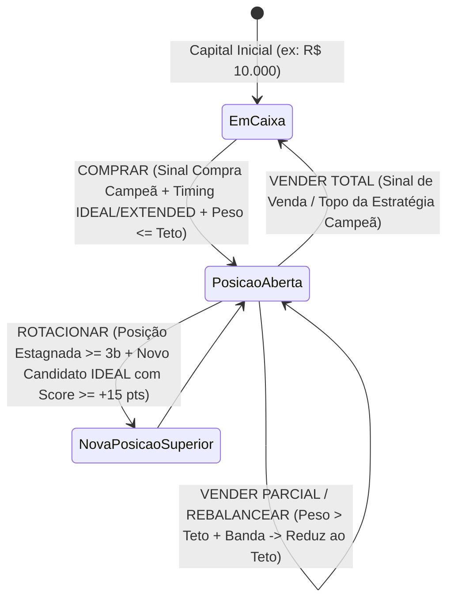

# Data Model: Gestor, Consultor de Rebalanceamento e Simulador Multiativos de Carteira

**Feature**: `016-portfolio-manager-simulator`  
**Date**: 2026-10-22

---

## 1. Domain Entities (`src/evaluator/portfolio_simulator.py`)

### 1.1 `PortfolioHolding`
Representa uma posição em carteira (seja informada pelo usuário na carteira atual ou mantida durante o backtest histórico).

| Field | Type | Description | Validation / Rules |
|---|---|---|---|
| `ticker` | `str` | Código do ativo normalizado (ex: `PETR4.SA`, `BTC-USD`) | Obrigatório, uppercase |
| `asset_name` | `str` | Nome amigável da empresa/ativo | Derivado de `get_asset_name(ticker)` |
| `shares` | `float` | Quantidade de cotas/ações detidas | `> 0.0` |
| `average_buy_price` | `float` | Preço médio ponderado de aquisição | `> 0.0` |
| `current_price` | `float` | Último preço de mercado conhecido | `> 0.0` |
| `market_value` | `float` | Valor atual da posição (`shares * current_price`) | `>= 0.0` |
| `invested_value` | `float` | Custo total de aquisição (`shares * average_buy_price`) | `>= 0.0` |
| `unrealized_pnl_value` | `float` | Lucro/Prejuízo latente em moeda (`market_value - invested_value`) | Qualquer `float` |
| `unrealized_pnl_pct` | `float` | Rentabilidade latente percentual | `((current_price / average_buy_price) - 1) * 100` |
| `current_weight_pct` | `float` | Participação percentual sobre o patrimônio total da carteira | `0.0` a `100.0` |
| `entry_bar_index` | `int` | Índice da barra em que a posição foi aberta na linha do tempo | `>= 0` (usado para filtro anti-churning $\ge 3$ barras) |

---

### 1.2 `AssetOpportunityProfile`
Perfil quantitativo consolidado para cada ativo do universo alvo e da carteira atual, contendo o Par de Estratégias Campeão e o Score de Potencial.

| Field | Type | Description | Validation / Rules |
|---|---|---|---|
| `ticker` | `str` | Código do ativo | Obrigatório |
| `asset_name` | `str` | Nome amigável do ativo | String |
| `category` | `str` | Categoria do ativo (`Ações Brasil`, `FIIs Brasil`, etc.) | String |
| `current_price` | `float` | Preço de fechamento da última barra | `> 0.0` |
| `champion_buy_id` | `str` | `strategy_sub_id` da estratégia de compra campeã | Extraído via `optimize_strategy_pairs` |
| `champion_buy_label` | `str` | Nome amigável em português da estratégia de compra campeã | String |
| `champion_sell_id` | `str` | `strategy_sub_id` da estratégia de venda campeã | Extraído via `optimize_strategy_pairs` |
| `champion_sell_label` | `str` | Nome amigável em português da estratégia de venda campeã | String |
| `win_rate_pct` | `float` | Taxa de acerto histórica do par campeão (%) | `0.0` a `100.0` |
| `historical_return_pct` | `float` | Retorno acumulado histórico do par campeão (%) | Qualquer `float` |
| `max_drawdown_pct` | `float` | Drawdown máximo histórico do par campeão (%) | `<= 0.0` |
| `closed_trades` | `int` | Número de ciclos fechados pelo par campeão no período | `>= 0` |
| `active_direction` | `str` | Direção do sinal mais relevante hoje (`BUY`, `SELL`, `NEUTRAL`) | Enum lógico |
| `timing_category` | `str` | Classificação de timing (`IDEAL`, `EXTENDED`, `LATE`) | Enum lógico |
| `timing_label` | `str` | Rótulo descritivo do timing | String |
| `distance_pct` | `float` | Distância percentual do preço atual ao nível recomendado | `float` |
| `recommended_price` | `float` | Preço de gatilho/referência do sinal ativo | `> 0.0` |
| `potential_score` | `float` | Nota composta de potencial de valorização | `0.0` a `100.0` (arredondado 1 casa decimal) |

---

### 1.3 `PortfolioActionRecommendation`
Item acionável do **Plano de Ação de Hoje** gerado pelo Consultor de Rebalanceamento (`/api/portfolio/advise`).

| Field | Type | Description | Validation / Rules |
|---|---|---|---|
| `ticker` | `str` | Código do ativo | Obrigatório |
| `asset_name` | `str` | Nome amigável do ativo | String |
| `action_type` | `str` | `BUY` \| `SELL_FULL` \| `SELL_PARTIAL_REBALANCE` \| `ROTATE_OUT` \| `ROTATE_IN` \| `HOLD` | Enum estrito |
| `action_label` | `str` | Rótulo em português (`COMPRAR`, `VENDER TOTAL`, `VENDER PARCIAL / REBALANCEAR`, `ROTACIONAR (SAÍDA)`, `ROTACIONAR (ENTRADA)`, `MANTER`) | String |
| `reason_text` | `str` | Explicação clara do motivo quantitativo da recomendação | String |
| `strategy_sub_id` | `str` | ID da estratégia campeã acionada | String |
| `strategy_label` | `str` | Nome amigável da estratégia campeã | String |
| `potential_score` | `float` | Score de Potencial do ativo (0 a 100) | `0.0` a `100.0` |
| `timing_category` | `str` | `IDEAL` \| `EXTENDED` \| `LATE` | String |
| `current_price` | `float` | Preço de mercado atual | `> 0.0` |
| `reference_price` | `float` | Preço recomendado de execução | `> 0.0` |
| `current_shares` | `float` | Quantidade atual em carteira antes da ordem | `>= 0.0` |
| `recommended_shares_delta` | `float` | Quantidade exata a comprar (`> 0`), vender (`< 0`) ou `0` (`HOLD`) | Inteiro para `.SA`, até 4 dec. para outros |
| `target_shares` | `float` | Quantidade final projetada pós-execução | `>= 0.0` |
| `order_value` | `float` | Valor financeiro estimado da ordem em R$ (`abs(delta) * current_price`) | `>= 0.0` |
| `current_weight_pct` | `float` | Peso percentual atual na carteira | `0.0` a `100.0` |
| `target_weight_pct` | `float` | Peso percentual projetado após o rebalanceamento | `0.0` a `max_weight_pct` |

---

### 1.4 `PortfolioLedgerEvent`
Evento histórico individual registrado durante o backtest multiativos (`/api/portfolio/simulate`).

| Field | Type | Description | Validation / Rules |
|---|---|---|---|
| `event_id` | `int` | Sequencial único da operação | `>= 1` |
| `date` | `str` | Data/hora de execução da barra (`YYYY-MM-DD` ou `YYYY-MM-DD HH:MM`) | String |
| `ticker` | `str` | Código do ativo operado | String |
| `asset_name` | `str` | Nome amigável do ativo | String |
| `event_type` | `str` | `BUY` \| `SELL_FULL` \| `SELL_PARTIAL_REBALANCE` \| `ROTATE_OUT` \| `ROTATE_IN` | Enum estrito |
| `event_label` | `str` | Rótulo amigável (`COMPRA`, `VENDA TOTAL (TOPO)`, `REBALANCEAMENTO PARCIAL`, `ROTAÇÃO (SAÍDA)`, `ROTAÇÃO (ENTRADA)`) | String |
| `strategy_sub_id` | `str` | Estratégia campeã que originou a decisão | String |
| `strategy_label` | `str` | Nome em português da estratégia | String |
| `potential_score` | `float` | Score de Potencial do ativo no instante da decisão | `0.0` a `100.0` |
| `execution_price` | `float` | Preço causal de execução na abertura/reteste da barra | `> 0.0` |
| `shares_delta` | `float` | Cotas negociadas (`+` na compra, `-` na venda) | `!= 0.0` |
| `trade_value` | `float` | Montante financeiro bruto movimentado | `> 0.0` |
| `realized_pnl_value` | `Optional[float]` | Lucro/Prejuízo realizado em R$ (apenas em vendas/rotações de saída) | `None` em compras |
| `realized_pnl_pct` | `Optional[float]` | Retorno percentual realizado sobre o preço médio da posição | `None` em compras |
| `weight_before_pct` | `float` | Peso do ativo no patrimônio antes do evento | `0.0` a `100.0` |
| `weight_after_pct` | `float` | Peso do ativo no patrimônio imediatamente após o evento | `0.0` a `100.0` |
| `cash_after` | `float` | Saldo de caixa livre da carteira após a operação | `>= 0.0` |
| `portfolio_equity_after` | `float` | Patrimônio total da carteira após a operação | `> 0.0` |

---

### 1.5 `PortfolioSimulationResult`
Estrutura consolidada retornada pelo motor de backtest histórico multiativos.

| Field | Type | Description |
|---|---|---|
| `initial_capital` | `float` | Capital inicial da simulação (ex: `10000.0`) |
| `final_equity` | `float` | Patrimônio total ao final do período (posições + caixa) |
| `final_cash` | `float` | Saldo final em caixa livre |
| `final_invested_value` | `float` | Valor de mercado das posições abertas no último dia |
| `net_profit` | `float` | Lucro líquido (`final_equity - initial_capital`) |
| `total_return_pct` | `float` | Rentabilidade percentual acumulada da carteira gerenciada |
| `benchmark_return_pct` | `float` | Rentabilidade do Buy & Hold Equal-Weight da cesta no mesmo período |
| `alpha_vs_benchmark_pct` | `float` | Excesso de retorno (`total_return_pct - benchmark_return_pct`) |
| `max_drawdown_pct` | `float` | Maior queda percentual do pico ao vale da curva patrimonial |
| `win_rate_pct` | `float` | Percentual de saídas (`SELL_FULL`, `SELL_PARTIAL_REBALANCE`, `ROTATE_OUT`) encerradas com lucro (`realized_pnl_value > 0`) |
| `profit_factor` | `float` | Soma dos lucros realizados dividida pelo módulo da soma dos prejuízos realizados |
| `total_events_count` | `int` | Total de operações executadas no livro razão |
| `closed_exits_count` | `int` | Total de vendas totais/parciais/rotações executadas |
| `winning_exits_count` | `int` | Total de saídas lucrativas |
| `losing_exits_count` | `int` | Total de saídas com prejuízo |
| `rebalance_rotations_count` | `int` | Contagem específica de rebalanceamentos parciais + rotações táticas |
| `current_holdings` | `List[PortfolioHolding]` | Posições abertas remanescentes ao fim da simulação |
| `opportunity_profiles` | `List[AssetOpportunityProfile]` | Ranking dos ativos do universo pelo Score de Potencial |
| `ledger_events` | `List[PortfolioLedgerEvent]` | Histórico cronológico completo de operações |
| `curve` | `List[PortfolioCurvePoint]` | Série diária contendo `date`, `portfolio_equity`, `cash_balance`, `invested_equity`, `benchmark_equity`, `drawdown_pct` |

---

## 2. State Transitions (Ciclo de Vida de uma Posição na Carteira)

